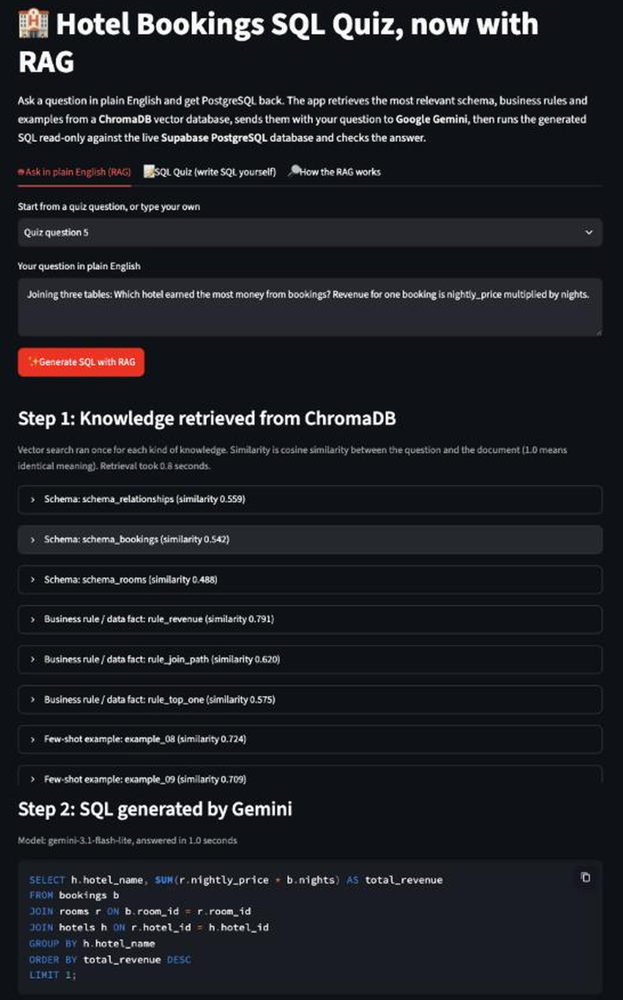
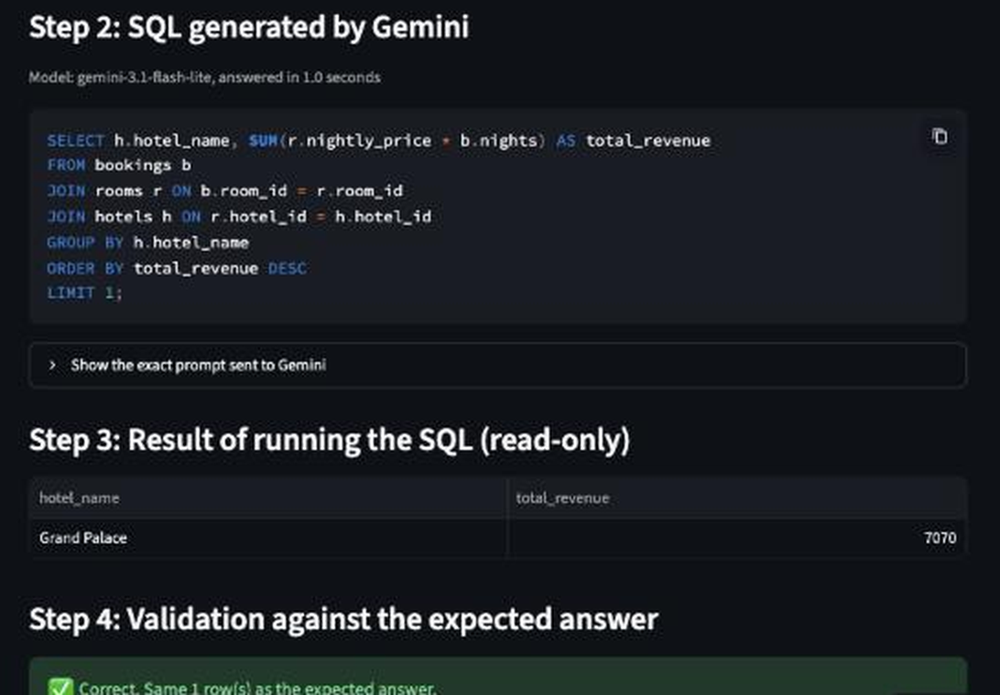

# Hotel Bookings SQL Quiz with RAG Text-to-SQL

[](https://github.com/mbaqirdilawari/hotel-sql-quiz-rag/actions/workflows/tests.yml)

**Live app:** https://hotel-sql-rag.streamlit.app

Ask a question about a hotel bookings database in plain English and get PostgreSQL back. The app uses **Retrieval-Augmented Generation (RAG)**: it retrieves the most relevant knowledge from a **ChromaDB** vector database, sends it with the question to **Google Gemini**, and then (bonus) runs the generated SQL read-only against the live **Supabase PostgreSQL** database and checks the result against the expected answer.

Built for the IDS 706 Week 8 Assignment (Build a RAG-Powered Text-to-SQL Application). It extends my Week 7 SQL quiz ([hotel-sql-quiz](https://github.com/mbaqirdilawari/hotel-sql-quiz)), which is still included as its own tab.

---

## Contents

1. [How to use the app](#how-to-use-the-app)
2. [Screenshots](#screenshots)
3. [RAG architecture](#rag-architecture)
4. [What is in the vector database](#what-is-in-the-vector-database)
5. [AI API](#ai-api)
6. [Bonus: automatic execution and validation](#bonus-automatic-execution-and-validation)
7. [Security](#security)
8. [Repository structure](#repository-structure)
9. [How to run it yourself](#how-to-run-it-yourself)
10. [How AI was used](#how-ai-was-used)

---

## How to use the app

1. Open https://hotel-sql-rag.streamlit.app. If Streamlit says the app is asleep, click **Yes, get this app back up!** and wait about 30 seconds.
2. In the sidebar, click **Create account** and enter any email and a password of at least 6 characters. You are signed in straight away.
3. On the **Ask in plain English (RAG)** tab, pick one of the 5 quiz questions (or **Type my own question**) and click **Generate SQL with RAG**.
4. The page then shows, in order:
   - **Step 1:** the documents retrieved from ChromaDB, with their similarity scores
   - **Step 2:** the SQL written by Gemini (and the exact prompt that was sent)
   - **Step 3:** the result table from running that SQL read-only
   - **Step 4:** whether the result matches the quiz question's expected answer

The **SQL Quiz** tab is the Week 7 quiz, where you write the SQL yourself. The **How the RAG works** tab lists every document stored in the vector database.

The first question after the app wakes up takes a little longer, because ChromaDB builds the vector database and downloads its small embedding model.

---

## Screenshots

**A question and its generated SQL**



**Bonus: executed SQL, result table and validation outcome**



---

## RAG architecture

```
                       ┌──────────────────────────────┐
  App start-up         │ Supabase PostgreSQL          │
  (once per server)    │ information_schema + data    │
                       └──────────────┬───────────────┘
                                      │ live schema, keys, real values
                                      v
                       ┌──────────────────────────────┐
                       │ Knowledge documents (27)     │
                       │ schema · rules/facts · examples
                       └──────────────┬───────────────┘
                                      │ embedded with all-MiniLM-L6-v2
                                      v
                       ┌──────────────────────────────┐
                       │ ChromaDB collection          │
                       │ (cosine similarity)          │
                       └──────────────┬───────────────┘
                                      │
  Each question:                      │
  user question ──> vector search ────┘ top 3 schema + top 3 rules/facts + top 3 examples
                         │
                         v
                 prompt = retrieved context + question
                         │
                         v
                 Google Gemini ──> generated SQL
                         │
                         v  (bonus)
                 run as read-only quiz_taker ──> result table
                         │
                         v  (bonus)
                 compare with the quiz question's expected answer ──> Correct / Incorrect
```

The workflow is exactly **User question → Vector retrieval → LLM → Generated SQL**. The database information is not pasted into the prompt wholesale: only the documents that vector search returns for this question are sent to Gemini. The prompt is shown in the app, so you can see what was retrieved and used.

| Step | Code |
|---|---|
| Read the live schema and data facts from PostgreSQL | [`rag/knowledge.py`](rag/knowledge.py) `load_live_schema` |
| Turn them into documents, add business rules and few-shot examples | [`rag/knowledge.py`](rag/knowledge.py) `build_documents` |
| Store and search the documents in ChromaDB | [`rag/vector_store.py`](rag/vector_store.py) |
| Build the prompt and call Gemini | [`rag/llm.py`](rag/llm.py) |
| Compare the result with the expected answer | [`rag/validate.py`](rag/validate.py) |
| Streamlit interface, sign-in, read-only execution | [`app.py`](app.py), [`db.py`](db.py) |

---

## What is in the vector database

27 documents in three kinds. Retrieval runs once per kind, so every prompt gets some table structure, some business rules and some worked examples, each chosen by similarity to the question.

| Kind | Count | Where it comes from | Example |
|---|---|---|---|
| **Schema** | 4 | Built from the **live PostgreSQL catalog** (`information_schema.columns` and the primary and foreign keys), plus a plain-English meaning for each column | `Table rooms ... hotel_id (integer, foreign key to hotels.hotel_id)` |
| **Business rules and data facts** | 11 | 9 hand-written rules (revenue, join path, star ratings, rounding, stay length, and so on) plus 2 documents of **real values read from the data** (city names, room types, date and price ranges) | `The revenue from one booking is rooms.nightly_price multiplied by bookings.nights` |
| **Few-shot examples** | 12 | Question and SQL pairs that are **similar to, but not the same as**, the quiz questions, so the AI has to adapt a pattern rather than copy an answer | `Which room type earned the least revenue?` |

ChromaDB runs inside the app (an in-memory collection) and embeds documents with its built-in **all-MiniLM-L6-v2** model, so retrieval needs no extra API key. The collection is rebuilt from the live database every time the app starts, so the schema documents always match the database.

---

## AI API

**Google Gemini**, through the official `google-genai` Python SDK and a Google AI Studio API key.

- The app uses `gemini-3.1-flash-lite`, which is on the free tier and usually answers in about a second. If it is unavailable, it falls back to `gemini-flash-latest` (Google's current Flash model) and then `gemini-3-flash-preview`. Each model gets at most 45 seconds before the next one is tried. A specific model can be set with the `GEMINI_MODEL` setting.
- Temperature is 0, so the same question gives the same SQL.
- A system instruction tells Gemini to use only the retrieved context and to reply with one read-only PostgreSQL `SELECT` statement.

---

## Bonus: automatic execution and validation

**Automatic SQL execution.** The generated SQL runs automatically as the `quiz_taker` Postgres role, which can only `SELECT` from `hotels`, `rooms` and `bookings`. Every `quiz_taker` transaction is read-only, queries time out after 5 seconds, and the connection itself is also set to read-only. The result table is shown in the app.

**Result validation.** For the 5 quiz questions, the app also runs the question's stored hint SQL, then compares the two results in [`rag/validate.py`](rag/validate.py). Two results count as the same when they have the same rows, ignoring:

- row order (for example, the tie between Islamabad and Karachi in question 2),
- column names (`total` versus `total_revenue`),
- number formatting (`7070` versus `7070.00`, `172.5` versus `172.50`),
- column order, as a second, looser check.

The app shows **Correct** or **Incorrect** with the reason, and the expected result table. Custom questions have no expected answer, so they are executed but not validated.

Every execution is also written to the append-only `audit_log` table from Week 7.

---

## Security

| Measure | Why |
|---|---|
| Generated SQL runs only as the read-only `quiz_taker` role | Even if the AI wrote `DELETE` or `DROP`, it would fail with a permission error |
| Sign-in (Supabase Auth) is required to generate SQL | Protects the Gemini API quota and the database from anonymous use |
| Passwords and the API key live in `.env` locally and in Streamlit secrets online | Nothing secret is committed. `.env` is in `.gitignore`, and only the empty template `.env.example` is in the repo |
| Queries the app writes itself use parameters | No f-string SQL anywhere in the repo |

---

## Repository structure

```
hotel-sql-quiz-rag/
├── app.py                    # Streamlit app: RAG tab, Week 7 quiz tab, knowledge base tab
├── db.py                     # Postgres connections, read-only execution, Supabase Auth
├── rag/
│   ├── knowledge.py          # Live schema reader and the 27 knowledge documents
│   ├── vector_store.py       # ChromaDB collection and retrieval
│   ├── llm.py                # Prompt building and Gemini SQL generation
│   └── validate.py           # Result comparison for the bonus validation
├── tests/                    # Unit tests (no database or API key needed)
├── sql/                      # Week 7 database setup (tables, data, quiz, quiz_taker role)
├── .github/workflows/tests.yml   # Runs the unit tests on every push
├── requirements.txt
├── .env.example              # Settings template with no secrets
└── .gitignore
```

---

## How to run it yourself

**1. Database.** This app reuses the Week 7 Supabase database. To create your own, make a free Supabase project and run `sql/01_seed.sql`, then `sql/02_quiz_setup.sql` in the SQL Editor (the second file prints a password for the `quiz_taker` role). In **Authentication**, turn **Confirm email** off.

**2. Gemini API key.** Go to aistudio.google.com, sign in, click **Get API key**, then **Create API key**.

**3. Run locally (Terminal):**

```bash
git clone https://github.com/mbaqirdilawari/hotel-sql-quiz-rag.git
cd hotel-sql-quiz-rag
cp .env.example .env
```

Fill in the empty values in `.env` (Supabase publishable key, Session pooler host, database password, `quiz_taker` password, Gemini API key). Then:

```bash
python3 -m venv .venv
source .venv/bin/activate
pip install -r requirements.txt
streamlit run app.py
```

**4. Run the unit tests (Terminal):**

```bash
pip install -r requirements-dev.txt
python -m pytest -v tests
```

**5. Deploy.** On Streamlit Community Cloud, create an app from this repo with main file `app.py` and Python 3.12, and paste the `.env` values into **Advanced settings**, **Secrets** in TOML format (`NAME = "value"`).

---

## How AI was used

This was an AI-assisted assignment. I used Claude (Anthropic) as a coding assistant to design the RAG pipeline and knowledge documents, write the code, tests and this README, and to set up the repository and Streamlit deployment through my browser. I chose the approach (Gemini, ChromaDB, a new repo that extends Week 7), created and handled all credentials myself (the Gemini API key and the Streamlit secrets were entered by me, not by the assistant), and reviewed the finished app before submitting.
